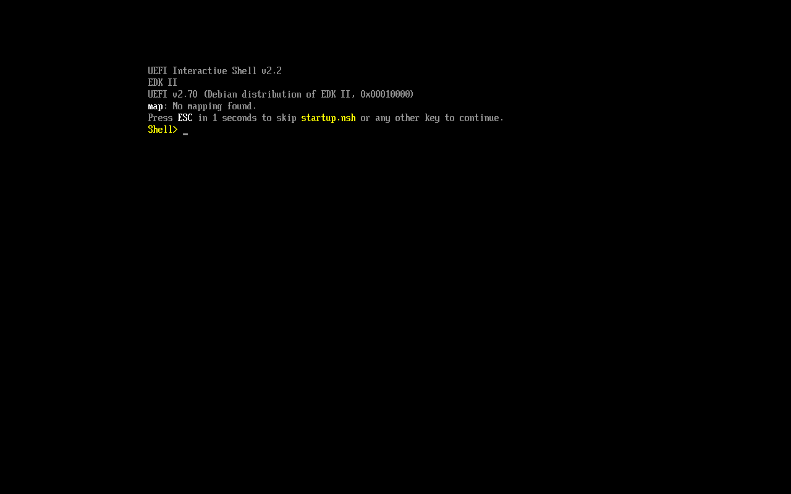

# rsvga

Carte graphique virtuelle VMware SVGA II, écrite en Rust, pour accélérer DirectX 9 à 11 dans les VM Windows sous QEMU/KVM, sans passthrough GPU.

- Windows utilise le pilote VMware SVGA officiel, déjà signé.
- rsvga tourne **à côté** de QEMU, dans un processus sandboxé, et s'y branche par vfio-user.
- Le rendu passe directement par Vulkan sur le GPU de l'hôte.

Statut : **M2 atteint**. Avec le QEMU patché, le firmware UEFI s'affiche sur rsvga grâce à son propre pilote UEFI, puis **Windows 11 tourne avec le pilote VMware SVGA officiel dans son mode moderne** : objets guest-backed (MOB, surfaces), command buffers, Screen Targets, curseur matériel, interruptions, bureau net en 1920×1080, et Windows suit la taille de la fenêtre (avec les VMware Tools). Le pilote écrit son journal à l'hôte, ce qui guide la suite. **M3 (3D) en cours** : avec la 3D annoncée à titre d'essai, DWM crée son périphérique Direct3D 11 (niveau 10_1) sur la carte et lui envoie ses commandes de rendu, que rsvga n'exécute pas encore. Le détail est dans [ARCHITECTURE.md](ARCHITECTURE.md).



## Compiler et tester

```bash
cargo test --workspace
```

Fuzzing avec libFuzzer, sur la toolchain stable (ni cargo-fuzz ni nightly) :

```bash
fuzz/run.sh fifo 60
```

```bash
fuzz/run.sh decode 60
```

```bash
fuzz/run.sh dx 60
```

## QEMU patché

Deux petits patchs :

- Les pilotes VMware parlent à la carte par des accès non alignés, que QEMU refuse sur les régions vfio. [0001](patches/qemu/0001-vfio-user-pass-unaligned-region-accesses-through.patch) corrige ça pour vfio-user seulement.
- Le pilote Windows demande les capacités de la carte à l'hyperviseur par le port VMware (commande 75), et y écrit son journal (GuestRPC). [0002](patches/qemu/0002-vmport-answer-SVGA-capability-queries-and-GuestRPC.patch) ajoute les deux, désactivés par défaut ; `run-windows.sh` les active avec les valeurs que donne `rsvga --vmport-args`. Pour construire QEMU 11.1.2 patché dans `target/qemu/install`, sans toucher au QEMU du système :

```bash
sudo apt install libpixman-1-dev libslirp-dev libgtk-3-dev libfdt-dev
```

```bash
scripts/build-qemu.sh
```

Pilote UEFI de la carte (servi depuis sa ROM, voir `--rom`) :

```bash
scripts/build-firmware.sh
```

Tests de bout en bout (rsvga + QEMU + OVMF) : registres pilotés comme par un vrai pilote, puis console UEFI affichée par notre pilote :

```bash
scripts/smoke-qemu.py
```

```bash
scripts/smoke-qemu.py --firmware
```

## Lancer Windows sur rsvga

Une fois QEMU, le pilote UEFI et rsvga (avec fenêtre) construits, `scripts/run-windows.sh` démarre une VM Windows dans la fenêtre de rsvga. Le disque passe toujours par une couche qcow2 temporaire (`target/vm/overlay.qcow2`), si bien que l'image d'origine n'est jamais écrite :

```bash
scripts/run-windows.sh --disk /chemin/windows.qcow2 --vars /chemin/OVMF_VARS_4M.fd
```

Le pilote VMware se trouve dans les VMware Tools : il faut extraire `vm3d.inf` et ses fichiers, puis lancer `pnputil /add-driver vm3d.inf /install` dans Windows.

Programmes de test côté invité (mingw-w64), donnés à la VM par `run-windows.sh --guest-tools` ; `d3dprobe.exe` rapporte à l'hôte, par la porte dérobée VMware, ce que Direct3D voit de la carte :

```bash
scripts/build-guest-tools.sh
```

## Lancer la carte

```bash
cargo build --release -p rsvga-server
```

```bash
target/release/rsvga --socket $XDG_RUNTIME_DIR/rsvga.sock --rom target/firmware/rsvga-gop.efi --snapshot /tmp/rsvga.png
```

Côté QEMU, la RAM du guest doit être partagée (memfd), et la carte s'ajoute ainsi :

```text
-object memory-backend-memfd,id=mem,size=4G,share=on -machine memory-backend=mem
-device '{"driver":"vfio-user-pci","socket":{"type":"unix","path":"/run/user/1000/rsvga.sock"}}'
```

Fenêtre interactive (compiler avec `--features window`) : `--window` affiche l'écran du guest, et `--qmp CHEMIN` transmet clavier et souris à QEMU par son socket QMP (`-qmp unix:CHEMIN,server=on,wait=off` côté QEMU). Les touches sont envoyées par position physique : un clavier AZERTY sur l'hôte et dans Windows s'accordent touche pour touche. La souris passe en absolu, par une tablette USB (`-device qemu-xhci -device usb-tablet`).

```bash
cargo build --release -p rsvga-server --features window
```

```bash
target/release/rsvga --socket $XDG_RUNTIME_DIR/rsvga.sock --rom target/firmware/rsvga-gop.efi --window --qmp $XDG_RUNTIME_DIR/qemu-qmp.sock
```

`RSVGA_TRACE=1` journalise chaque accès aux registres SVGA (par nom), chaque commande FIFO et, toutes les 5 secondes, l'état de la FIFO ; `RSVGA_TRACE=2` ajoute les accès bruts (espace PCI...).

## Ce qui existe

- `svga-proto` : registres, FIFO, capacités et identifiants de commandes du protocole VMware SVGA II.
- `svga-core` : FIFO validée, décodage de toutes les commandes 2D et de l'encadrement 3D, registres SVGA (modes, ID, palette...). Rust sûr, borné, protégé contre un invité qui modifierait une commande pendant sa lecture.
- `vfio-user` : protocole vfio-user côté serveur, avec passage de descripteurs de fichiers.
- `rsvga-server` : la carte complète (config PCI, VRAM et FIFO en memfd scellés, ROM optionnelle, exécution de la FIFO, capture PNG, fenêtre optionnelle).
- `firmware/gop` : pilote UEFI GOP en Rust `no_std` (7 Ko), livré dans la ROM de la carte.
- `guest/d3dprobe` : sonde Direct3D côté Windows.
- 137 tests, dont un test de stress sur 20 000 FIFO aléatoires et une session vfio-user de bout en bout ; trois cibles de fuzzing.

L'audit de qemu-vmvga qui a motivé ce projet est dans [docs/audit-qemu-vmvga.md](docs/audit-qemu-vmvga.md).

## Licence

MIT OR Apache-2.0 (proposition). Les constantes de `svga-proto` sont transcrites des en-têtes VMware sous licence MIT : voir `crates/svga-proto/VMWARE-NOTICE.txt`.
